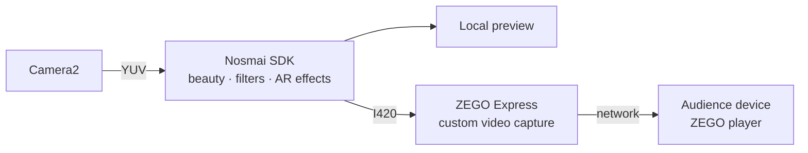

# Nosmai × ZEGOCLOUD — Android Live Streaming Quickstart

A minimal Android sample that shows how to broadcast a live stream with **Nosmai** beauty, filters and AR effects over the **ZEGOCLOUD Express Video SDK**.

Nosmai renders the effects on the host's device. Each processed frame is handed to ZEGOCLOUD through custom video capture, so viewers receive exactly what the host sees — no extra work is needed on the audience side.


## Features

- **Go live as a host** with the Nosmai effects pipeline
- **Watch as an audience member** on a second device
- **Beauty controls** — skin smoothing, whitening, face slimming, eye enlargement, sharpening
- **Cloud filters and AR effects** — browsed with thumbnails, downloaded on demand, applied in one tap
- **Front / back camera switch**
- **Live FPS counter** for both host (frames sent) and audience (frames rendered)

## How it works



1. On Android the app owns the camera. `Camera2Helper` opens it and passes every YUV frame to Nosmai.
2. Nosmai is initialised with your license key, renders the effects into its preview view, and returns each processed frame as I420.
3. ZEGO Express is configured for **custom video capture**, so it takes frames from the app instead of opening the camera itself.
4. The host logs in to a room and starts publishing. ZEGO then calls `onStart`, and from then on every processed frame is sent with `sendCustomVideoCaptureRawData`.
5. The audience logs in to the same room and plays the host's stream as soon as it appears.

## Requirements

| | |
|---|---|
| Android Studio | A version that supports Android Gradle Plugin 8.9 (Meerkat or later) |
| JDK | 17 |
| Android | 7.0 (API 24) or later |
| Devices | Two physical Android phones (arm64-v8a or armeabi-v7a) — one to host, one to watch. Emulators are not supported. |
| Accounts | A Nosmai license key and a [ZEGOCLOUD](https://console.zegocloud.com) project |

## Getting started

### 1. Clone and open

```sh
git clone https://github.com/HashirYamin-dev/quick-start-nosmai-zegocloud-livestreaming-app-android.git
```

Open the folder in Android Studio and let Gradle sync. Both SDKs are downloaded by Gradle — ZEGO Express from ZEGOCLOUD's Maven repository and the Nosmai SDK from its GitHub release — so there is nothing to add by hand.

### 2. Set your application ID

In `app/build.gradle.kts`, change `applicationId` to your own:

```kotlin
applicationId = "com.yourcompany.yourapp"
```

> **Important:** a Nosmai license key only works with the application ID it was issued for. Create your key for the same application ID you set here.

### 3. Get your keys

- **Nosmai** — create a license key for your application ID in the Nosmai dashboard.
- **ZEGOCLOUD** — create a project in the [ZEGOCLOUD Console](https://console.zegocloud.com) and copy its **AppID** and **AppSign**. This sample authenticates with the AppSign, so no token is required.

### 4. Add the keys

Open `app/src/main/java/com/nosmai/quickstart/zegocloud/DemoConfig.kt` and replace the placeholders:

```kotlin
const val NOSMAI_LICENSE_KEY = "YOUR_NOSMAI_LICENSE_KEY"
const val ZEGO_APP_ID = 0L // YOUR_ZEGO_APP_ID
const val ZEGO_APP_SIGN = "YOUR_ZEGO_APP_SIGN"
const val ZEGO_ROOM_ID = "demo-room"
```

| Value | Description |
|---|---|
| `NOSMAI_LICENSE_KEY` | Your Nosmai license key. |
| `ZEGO_APP_ID` | The numeric AppID of your ZEGOCLOUD project. Keep the `L` suffix. |
| `ZEGO_APP_SIGN` | The 64-character AppSign of your ZEGOCLOUD project — see [Going to production](#going-to-production). |
| `ZEGO_ROOM_ID` | Any room name. Host and audience must use the same one. |

### 5. Run

Build and run on both phones, from Android Studio or with:

```sh
./gradlew installDebug
```

1. On the first phone tap **Go Live (Host)** and allow camera and microphone access.
2. On the second phone tap **Watch (Audience)**.
3. On the host, use the **Beauty**, **Filters** and **AR Effects** tabs — the audience sees the result in real time.

The audience can join before or after the host. If the host leaves and goes live again, viewers who stayed in the room pick the stream up automatically.

## Project structure

```
app/src/main/java/com/nosmai/quickstart/zegocloud/
├── DemoConfig.kt       Your keys and room name
├── HomeActivity.kt     Role selection: host or audience
├── LiveActivity.kt     Nosmai pipeline + ZEGO room (the integration)
├── EffectsPanel.kt     Beauty sliders, cloud filters and AR effects UI
└── Camera2Helper.java  Opens the camera and delivers YUV frames
```

## Integration walkthrough

All of the code below is taken from `LiveActivity.kt` unless stated otherwise.

**Create the engine and enable custom video capture** — ZEGO will take frames from the app. This has to be configured before logging in to the room:

```kotlin
val profile = ZegoEngineProfile().apply {
    appID = DemoConfig.ZEGO_APP_ID
    appSign = DemoConfig.ZEGO_APP_SIGN
    scenario = ZegoScenario.BROADCAST
    application = getApplication()
}
val engine = ZegoExpressEngine.createEngine(profile, zegoEvents)

val capture = ZegoCustomVideoCaptureConfig().apply { bufferType = ZegoVideoBufferType.RAW_DATA }
engine.enableCustomVideoCapture(true, capture, ZegoPublishChannel.MAIN)
engine.setCustomVideoCaptureHandler(captureHandler)
// Send exactly what Nosmai rendered: no extra mirroring and no cropping.
engine.setVideoMirrorMode(ZegoVideoMirrorMode.NO_MIRROR)
engine.setCustomVideoCaptureFillMode(ZegoViewMode.ASPECT_FIT, ZegoPublishChannel.MAIN)
```

**Start Nosmai, show the local preview, and feed it the camera:**

```kotlin
NosmaiSDK.initialize(applicationContext, DemoConfig.NOSMAI_LICENSE_KEY)

val preview = NosmaiPreviewView(this)
videoContainer.addView(preview)
preview.initializePipeline()
NosmaiSDK.startProcessing(preview)

// startProcessing() does not open a camera: the app does, and feeds Nosmai.
val camera = Camera2Helper(this, isFrontCamera)
camera.setInputMode(Camera2Helper.InputMode.YUV)
camera.setFrameCallback { y, u, v, width, height, yStride, uStride, vStride, uPixelStride, vPixelStride ->
    preview.processYuvFrame(y, u, v, width, height, yStride, uStride, vStride,
        uPixelStride, vPixelStride, rotation)
}
camera.startCamera()
```

**Log in to the room and publish** once the login succeeds:

```kotlin
engine.loginRoom(DemoConfig.ZEGO_ROOM_ID, ZegoUser(userId), ZegoRoomConfig())

// In onRoomStateChanged, when reason == ZegoRoomStateChangedReason.LOGINED (host only):
engine.startPublishingStream(DemoConfig.STREAM_ID)
```

Every participant in a room needs a unique user ID.

**Start forwarding frames when ZEGO asks for them:**

```kotlin
private val captureHandler = object : IZegoCustomVideoCaptureHandler() {
    override fun onStart(channel: ZegoPublishChannel?) {
        // DUAL_OUTPUT keeps the on-screen preview and also delivers each processed frame.
        NosmaiSDK.setRenderMode(NosmaiSDK.RenderMode.DUAL_OUTPUT)
        NosmaiSDK.setFrameCallback { frame -> sendFrame(frame) }
    }
    override fun onStop(channel: ZegoPublishChannel?) {
        NosmaiSDK.setFrameCallback(null)
        NosmaiSDK.setRenderMode(NosmaiSDK.RenderMode.PREVIEW_ONLY)
    }
}
```

**Send every processed frame** as I420 raw data:

```kotlin
buffer.clear()
buffer.put(frame.pixelBuffer, 0, bytes)   // bytes = width * height * 3 / 2
buffer.flip()

frameParam.format = ZegoVideoFrameFormat.I420
frameParam.width = width
frameParam.height = height
frameParam.strides[0] = width
frameParam.strides[1] = width / 2
frameParam.strides[2] = width / 2
engine.sendCustomVideoCaptureRawData(buffer, bytes, frameParam, SystemClock.elapsedRealtime())
```

Nosmai reuses the byte array it passes to the frame callback, so copy the frame into your own direct `ByteBuffer` before the callback returns. The sample also sets the encode resolution to the size Nosmai produces, so ZEGO never scales or crops the frame.

**Show the host's video on the audience side:**

```kotlin
override fun onRoomStreamUpdate(roomID: String?, updateType: ZegoUpdateType?,
                                streamList: ArrayList<ZegoStream>?, extendedData: JSONObject?) {
    if (updateType != ZegoUpdateType.ADD) return
    val stream = streamList?.firstOrNull() ?: return
    engine.startPlayingStream(stream.streamID,
        ZegoCanvas(textureView).apply { viewMode = ZegoViewMode.ASPECT_FILL })
}
```

**Apply effects** (`EffectsPanel.kt`) — anything applied here is part of the frames sent to ZEGOCLOUD:

```kotlin
// Beauty: values range from 0.0 to 1.0
NosmaiBeauty.applySkinSmoothing(0.6f)
NosmaiBeauty.applyFaceSlimming(0.3f)

// Cloud filters and AR effects: list (off the main thread), download, then apply
val query = NosmaiCloud.FilterQuery().apply { filterType = "filter" }   // or "effects"
if (NosmaiCloud.fetch(query)) {
    val items = NosmaiCloud.list()
}
NosmaiCloud.download(item.id) { _, success, path, error ->
    if (success && path != null) NosmaiEffects.applyEffect(path, callback)
}

NosmaiEffects.clearFilter()
NosmaiEffects.clearAREffect()
```

**Leave:**

```kotlin
engine.stopPublishingStream()   // host; viewers call stopPlayingStream(streamId)
engine.logoutRoom()
ZegoExpressEngine.destroyEngine(null)
NosmaiSDK.cleanup()
```

## Troubleshooting

| Symptom | Likely cause |
|---|---|
| The home screen says a key is not set | A placeholder is still present in `DemoConfig.kt`. |
| Effects do not render, or the Nosmai license is reported invalid in Logcat | The license key is wrong, or `applicationId` does not match the one the key was issued for. |
| `ZEGO room error …` | The AppID or AppSign is wrong, or the ZEGOCLOUD project is not set up for AppSign authentication. |
| `ZEGO publish error …` or `ZEGO play error …` | The device is offline, or the project's service is not active in the ZEGOCLOUD Console. |
| The audience stays on "waiting for host" | The two devices are using different AppIDs or room IDs, or the host has not gone live yet. |
| A tab shows "not enabled for this Nosmai license" | Beauty or cloud filters are not part of your Nosmai plan. |
| A filter fails to download | The filter is not included in your Nosmai plan, or the device is offline. |
| The app does not install on an emulator | The Nosmai SDK ships `arm64-v8a` and `armeabi-v7a` libraries only; x86 emulators are not supported. |
| Gradle sync cannot resolve `com.nosmai:nosmai-sdk` or `im.zego:express-video` | Keep the `ivy` and `maven` repository blocks in `settings.gradle.kts`; they are where the two SDKs are downloaded from. |

## Going to production

This sample is intentionally small. Before shipping your own app:

- **Switch to token authentication.** The AppSign ships inside the app and can be extracted. For production, ZEGOCLOUD recommends generating a token on your server and passing it when logging in to the room.
- **Do not ship keys in source control.** Load them from your backend or a secure build configuration.
- **Handle interruptions** such as phone calls, app backgrounding and network changes according to your product's needs.
- **Set up your own release build.** The release build type in this sample has minification turned off and is signed with the debug key; add your own signing and R8 rules.

## Dependencies

| Library | Version |
|---|---|
| `com.nosmai:nosmai-sdk` | 3.0.7 |
| `im.zego:express-video` | 3.21.0 |
| Android Gradle Plugin | 8.9.1 |
| Kotlin | 2.1.0 |
